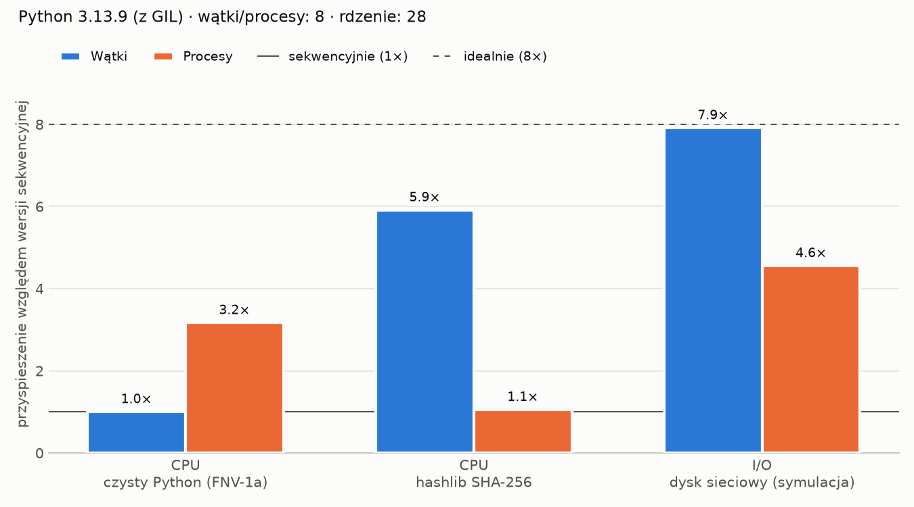

# dupfinder – wyszukiwarka zduplikowanych plików

Projekt zaliczeniowy z przedmiotu **Zaawansowane techniki programowania w języku Python**
(Informatyka, studia inżynierskie).

**Autor:** Hubert Kozioł
**Nr albumu:** 108652
**Prowadzący:** Bartosz Bryniarski

---

## 1. Opis projektu

`dupfinder` przegląda wskazane katalogi i wyszukuje pliki o **identycznej zawartości**
(niezależnie od nazwy i daty). Dla każdej grupy duplikatów wskazuje „oryginał” i kopie,
pokazuje, ile miejsca da się odzyskać, oraz zapisuje raporty w formatach TXT, JSON i CSV.
Program **niczego nie usuwa** – tylko raportuje.

Program porównuje pliki w trzech etapach. Każdy kolejny etap jest droższy, ale obejmuje coraz mniej plików:

| Etap | Co robi | Koszt | Wykonanie |
|---|---|---|---|
| 1. Rozmiar | Pliki o unikalnym rozmiarze nie mogą mieć duplikatu | tylko metadane | generatory |
| 2. Skrót częściowy | skrót (domyślnie SHA-256) z pierwszych i ostatnich 4 KiB pliku | 8 KiB odczytu na plik (I/O) | **wątki** |
| 3. Pełny skrót | SHA-256 (lub inny algorytm) całej zawartości | cały plik (CPU + I/O) | **procesy** (domyślnie) |

Etap 3 wykonuje się zawsze, bo dwa pliki o tym samym początku i końcu mogą różnić się
w środku. W danych testowych są takie pliki-pułapki. Pliki do 8 KiB są w całości
objęte skrótem częściowym, więc dla nich etap 3 jest pomijany.

**Który plik jest „oryginałem”?** Pierwszeństwo ma plik, którego nazwa nie wygląda na kopię.
Takie nazwy wykrywa wyrażenie regularne, np. `zdjecie (1).jpg`, `raport - Kopia.docx`,
`notatki copy 2.txt`. Jeśli takich plików jest kilka, wybierany jest najstarszy,
a przy równych datach ten o najkrótszej ścieżce.

## 2. Wymagania i instalacja

- Python **3.12+** (testowane na CPython 3.12 i 3.13),
- rdzeń aplikacji używa wyłącznie biblioteki standardowej,
- opcjonalnie: `matplotlib` (wykres w benchmarku), `pytest` (testy działają też z `unittest`).

```bash
git clone <adres-repozytorium> && cd dupfinder
python -m venv .venv
source .venv/bin/activate          # Windows: .venv\Scripts\activate
pip install -r requirements.txt    # opcjonalne – tylko wykresy i pytest
```

> Na Linuksie zamiast `python` może być potrzebne `python3`. Wszystkie polecenia
> uruchamiamy z katalogu głównego repozytorium.

## 3. Uruchomienie

### 3.1. Dane testowe

```bash
python -m scripts.generate_test_data            # tworzy katalog test_data/ (~76 MiB)
python -m scripts.generate_test_data --scale 5 --big-mb 64 --force   # więcej danych
```

Generator jest deterministyczny (stałe ziarno). Listę oczekiwanych grup duplikatów
zapisuje do `test_data/expected.json`, a testy porównują z nią wynik programu.

### 3.2. Wyszukiwanie duplikatów

```bash
python -m dupfinder test_data
python -m dupfinder test_data --mode threads --workers 8 --progress -v
python -m dupfinder ~/Zdjecia ~/Pobrane --min-size 100KB --include "\.(jpe?g|png)$"
python -m dupfinder test_data --exclude "(^|/)archiwum(/|$)" --report-dir raporty
python -m dupfinder --help
```

| Opcja | Znaczenie |
|---|---|
| `--min-size`, `--max-size` | filtr rozmiaru, np. `500`, `10KB`, `1.5MB`, `2G` (walidowany regexem) |
| `-i/--include REGEX` | tylko pliki, których **nazwa** pasuje do wzorca (można podać wiele razy) |
| `-e/--exclude REGEX` | pomiń ścieżki (względne), które pasują do wzorca |
| `--no-default-excludes` | nie pomijaj domyślnie `.git`, `node_modules`, `__pycache__`, `*.tmp`… |
| `-a/--algorithm` | `sha256` (domyślny), `sha1`, `md5`, `blake2b`, `fnv1a` (czysty Python – wolny) |
| `-m/--mode` | etap 3: `processes` (domyślnie), `threads`, `sequential` |
| `-w/--workers N` | liczba wątków/procesów |
| `-o/--report-dir`, `-f/--formats` | zapis raportów, np. `-f txt,json,csv` |
| `--progress`, `-v`, `-vv` | postęp na stderr, logi etapów, logi szczegółowe |

Przykładowy wynik:

```text
Przejrzano plików: 52 (76.3 MiB)
Grupy duplikatów: 15, zbędne kopie: 19, do odzyskania: 33.6 MiB
Czasy etapów:
  1. przegląd katalogów i grupowanie po rozmiarze         0.001 s
  2. skróty częściowe (wątki)                             0.011 s
  3. pełne skróty                                         0.060 s

Największe grupy (top 3):
[1] 2 × 16.0 MiB – do odzyskania 16.0 MiB (skrót d858ddb0632b…)
    oryginał: test_data/pobrane/film.mp4
    kopia:    test_data/archiwum/2023/film.mp4
[2] 3 × 8.0 MiB – do odzyskania 16.0 MiB (skrót a3b6fa1519d8…)
    oryginał: test_data/pobrane/instalator.bin
    kopia:    test_data/pobrane/instalator (1).bin
    kopia:    test_data/pobrane/instalator (2).bin
...
```

### 3.3. Benchmark GIL

```bash
python -m benchmarks.gil_benchmark --chart              # wyniki w benchmarks/results/
python -m benchmarks.gil_benchmark --workers 4 --repeats 5 --chart
python3.13t -m benchmarks.gil_benchmark --chart         # opcjonalnie: Python bez GIL
```

### 3.4. Testy

```bash
python -m unittest -v        # albo: python -m pytest
```

Jest 56 testów jednostkowych i integracyjnych. Sprawdzają dekoratory, regexy, iterator,
generatory, liczenie skrótów, licznik postępu przy wielu wątkach, wszystkie trzy tryby
wykonania na wygenerowanych danych, raporty i CLI.

## 4. Struktura projektu

```text
dupfinder/
├── __main__.py              # python -m dupfinder (z if __name__ == "__main__")
├── cli.py                   # argparse, kody wyjścia
├── report.py                # raporty TXT/JSON/CSV, zapis w puli wątków
├── core/
│   ├── models.py            # FileEntry, DuplicateGroup, ScanResult
│   ├── patterns.py          # wyrażenia regularne
│   ├── reader.py            # iterator ChunkReader
│   ├── walker.py            # generatory przeglądające katalogi
│   ├── hashing.py           # skróty: hashlib + FNV-1a w czystym Pythonie
│   └── finder.py            # DuplicateFinder – trzy etapy wyszukiwania
├── concurrency/
│   └── executors.py         # tryby sequential/threads/processes, Lock, Event
└── utils/
    ├── decorators.py        # measure_time, retry, stage, requires_result
    ├── formatting.py        # human_size
    └── logging_setup.py     # konfiguracja logging
benchmarks/gil_benchmark.py  # pomiar GIL + wykres
benchmarks/results/          # wyniki pomiarów (Markdown, JSON, PNG)
scripts/generate_test_data.py
tests/                       # unittest / pytest
```

## 5. Tabela mapowania: zagadnienie → miejsce w kodzie

| # | Zagadnienie | Gdzie w kodzie |
|---|---|---|
| 1 | Dekorator funkcji (bez parametrów) | `utils/decorators.py` → `measure_time`; użyty na `concurrency/executors.py` → `hash_many` i `report.py` → `export_reports` |
| 1 | Dekorator **z parametrami** | `utils/decorators.py` → `retry(attempts, delay, backoff, exceptions, reraise)`; użyty na `core/hashing.py` → `file_digest`, `partial_digest` |
| 1 | `functools.wraps` | wszystkie dekoratory w `utils/decorators.py` (bez `wraps` funkcji nie dałoby się przekazać do procesów – `pickle` szuka jej po `__qualname__`) |
| 2 | Dekorator metody korzystający z `self` | `utils/decorators.py` → `stage(name)` zapisuje czas etapu w `self.timings`, `requires_result` sprawdza `self._result`; użyte w `core/finder.py` → `DuplicateFinder._collect_by_size`, `_partial_hash_stage`, `_full_hash_stage`, `result`, `summary`, `export` |
| 2 | `@property` z setterem | `core/finder.py` → `DuplicateFinder.min_size`, `max_size`, `algorithm`, `mode`, `workers` (walidacja); `core/models.py` → `DuplicateGroup.original`, `copies`, `wasted_bytes` |
| 2 | `@classmethod` | `core/finder.py` → `DuplicateFinder.from_args` (alternatywny konstruktor z `argparse`) |
| 2 | `@staticmethod` | `core/finder.py` → `DuplicateFinder._validate_roots`, `_regroup`; `core/models.py` → `DuplicateGroup._original_rank` |
| 3 | Własny iterator (`__iter__`, `__next__`) | `core/reader.py` → klasa `ChunkReader` (czyta plik blokami; także menedżer kontekstu) |
| 3 | Własne obiekty iterowalne | `core/models.py` → `DuplicateGroup.__iter__`, `ScanResult.__iter__` |
| 4 | Funkcja-generator, `yield from` | `core/walker.py` → `walk_files` (rekurencyjne `yield from`), `unique_files`, `only_duplicates`; `core/finder.py` → `counted` |
| 4 | Wyrażenia generujące | `core/walker.py` → `filter_files`; `core/finder.py` → `_regroup` |
| 4 | Potok generatorów | `core/finder.py` → `_collect_by_size`: `walk_files → unique_files → filter_files → counted → group_by` |
| 5 | Regex – walidacja, grupy nazwane | `core/patterns.py` → `SIZE_RE` + `parse_size` (grupy `value`, `unit`) |
| 5 | Regex – ekstrakcja, grupy nazwane | `core/patterns.py` → `COPY_NAME_RE` + `parse_copy_name` (grupy `stem`, `number`, `marker`, `copy_no`, `ext`) |
| 5 | Regex – reguły wykluczeń | `core/patterns.py` → `DEFAULT_EXCLUDES`, `compile_patterns`, `matches_any`; `cli.py` → `regex_arg` |
| 6 | Wątki – zadania I/O | `concurrency/executors.py` → `hash_many(mode="threads")` (`ThreadPoolExecutor`), użyte w etapie 2 (`DuplicateFinder._partial_hash_stage`); `report.py` → `export_reports` (równoległy zapis raportów) |
| 6 | Synchronizacja (`Lock`, `Event`) | `concurrency/executors.py` → `ProgressTracker` (`threading.Lock`), `ProgressReporter` (`threading.Event`) |
| 7 | Procesy – zadanie CPU-bound | `concurrency/executors.py` → `hash_many(mode="processes")` (`ProcessPoolExecutor`), użyte w etapie 3 (`DuplicateFinder._full_hash_stage`) |
| 7 | `if __name__ == "__main__"` | `dupfinder/__main__.py`, `benchmarks/gil_benchmark.py` |
| 8 | Pomiar GIL | `benchmarks/gil_benchmark.py` (wyniki: `benchmarks/results/`); algorytm trzymający GIL: `core/hashing.py` → `FNV1a64` |

**Elementy dodatkowe:** testy (`tests/`, 56 testów), CLI (`cli.py`, `argparse`), logowanie
(`utils/logging_setup.py` i loggery w modułach), wykres `matplotlib`
(`gil_benchmark.save_chart`), adnotacje typów w całym projekcie, generator danych testowych,
raporty TXT/JSON/CSV.

## 6. Wyniki pomiarów wydajności

Benchmark wykonuje **ten sam kod aplikacji** (`hash_many` + `digest_entry`) w trzech trybach
i dla trzech scenariuszy. Wynik to mediana z 3 powtórzeń. Skrypt sprawdza też, czy każdy
tryb daje identyczne skróty.

Środowisko: Python 3.13.9 (CPython, z GIL), Windows 11 (AMD64), 28 procesorów logicznych,
8 wątków/procesów.

| Scenariusz | Dane | Sekwencyjnie | Wątki | Procesy | Przysp. wątki | Przysp. procesy |
|---|---|---:|---:|---:|---:|---:|
| CPU – czysty Python (FNV-1a) | 16 plików, 16.0 MiB | 0.87 s | 0.87 s | 0.28 s | 1.00× | 3.17× |
| CPU – hashlib SHA-256 | 16 plików, 256.0 MiB | 0.18 s | 0.03 s | 0.17 s | 5.92× | 1.05× |
| I/O – dysk sieciowy (symulacja) | 32 plików, 2.0 MiB | 1.62 s | 0.20 s | 0.36 s | 7.91× | 4.56× |



Opis scenariuszy:
- **FNV-1a** – skrót liczony w pętli Pythona bajt po bajcie, więc wątek przez cały czas trzyma GIL,
- **SHA-256** – `hashlib` (kod w C) zwalnia GIL na czas liczenia skrótu dużych bloków,
- **I/O** – przed odczytem każdego pliku jest opóźnienie 50 ms (`time.sleep`), które symuluje wolny dysk sieciowy.

## 7. Wnioski dotyczące GIL

1. W zadaniu liczonym w czystym Pythonie (FNV-1a) wątki nie dały żadnego przyspieszenia (1.00×), bo GIL pozwala wykonywać kod bajtowy tylko jednemu wątkowi naraz.
2. Procesy przyspieszyły to samo zadanie 3.17×, bo każdy ma własny interpreter i własny GIL. Do idealnych 8× zabrakło, ponieważ na Windowsie procesy startują metodą *spawn* (nowy interpreter i ponowny import modułów), a całe zadanie trwało tylko 0.87 s, więc koszt startu stanowił dużą część czasu.
3. Przy SHA-256 wątki przyspieszyły aż 5.92×, bo `hashlib` zwalnia GIL podczas liczenia skrótu. Procesy dały tylko 1.05×, bo cała praca trwała 0.18 s, czyli mniej więcej tyle, ile uruchomienie 8 procesów.
4. W scenariuszu I/O 8 wątków dało prawie idealne przyspieszenie 7.91×, ponieważ podczas czekania na operację wejścia/wyjścia GIL jest zwolniony. Procesy (4.56×) też przyspieszają, ale z większym narzutem.
5. GIL nie zwalnia z synchronizacji: licznik postępu aktualizowany z wielu wątków wymaga `threading.Lock`, bo `x += 1` to kilka instrukcji kodu bajtowego (test `test_no_lost_updates_with_many_threads`).
6. W projekcie skróty częściowe (wiele małych odczytów) liczą wątki. Pełne skróty domyślnie liczą procesy, bo tylko one przyspieszają algorytm w czystym Pythonie (`fnv1a`). Pomiary pokazują jednak, że dla domyślnego SHA-256 lepszy jest tryb `--mode threads`.
7. W kompilacji CPythona bez GIL (3.13t/3.14t) wątki powinny przyspieszać również scenariusz FNV-1a. Można to sprawdzić tym samym skryptem.

## 8. Problemy napotkane w trakcie realizacji

- **Przekazywanie funkcji do procesów.** `ProcessPoolExecutor` serializuje zadania przez `pickle`,
  więc nie da się przekazać lambdy ani funkcji zagnieżdżonej. Funkcje zadań są zdefiniowane na
  poziomie modułu, a parametry dołączane przez `functools.partial`. Dekoratory muszą używać
  `functools.wraps`, bo `pickle` odnajduje funkcję po `__qualname__`.
- **Pliki różniące się tylko środkiem.** Sam skrót częściowy dawałby fałszywe duplikaty,
  dlatego etap 3 jest obowiązkowy. Dane testowe zawierają taką pułapkę, a testy ją sprawdzają.
- **Ten sam plik policzony dwa razy.** Przy nakładających się katalogach startowych
  (np. `dane` i `dane/zdjecia`) albo twardych dowiązaniach ten sam plik trafiłby do wyników
  dwukrotnie. Pliki są więc identyfikowane po parze (urządzenie, i-węzeł).
- **Pętle przez dowiązania symboliczne.** Dowiązania są pomijane.
- **Wzorce wykluczeń.** Początkowo były dopasowywane do pełnej ścieżki, więc skanowanie katalogu
  leżącego np. wewnątrz `.venv` wykluczało wszystko. Teraz wzorce są dopasowywane do ścieżki
  względnej wobec katalogu startowego, tak jak w `.gitignore`.
- **Błędy dostępu.** Brak uprawnień albo plik usunięty w trakcie skanowania nie przerywa pracy:
  błąd trafia do raportu. Przejściowe błędy I/O są ponawiane dekoratorem `@retry`, a błędy trwałe
  (`FileNotFoundError`, `PermissionError`) nie.
- **Szum pomiarowy.** Czasy kolejnych powtórzeń różniły się między sobą, dlatego benchmark
  podaje medianę z kilku powtórzeń, a nie pojedynczy pomiar.